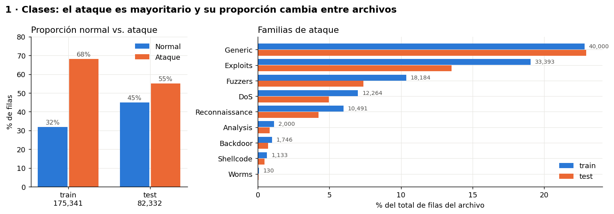
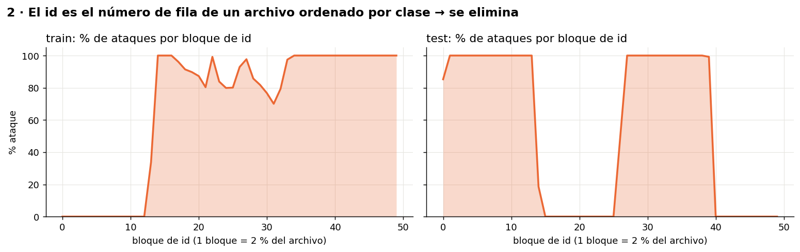
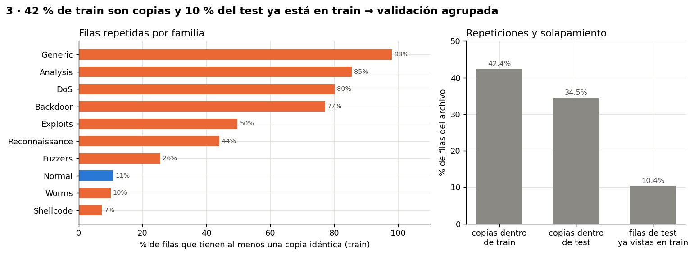
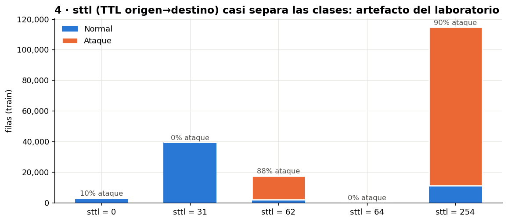
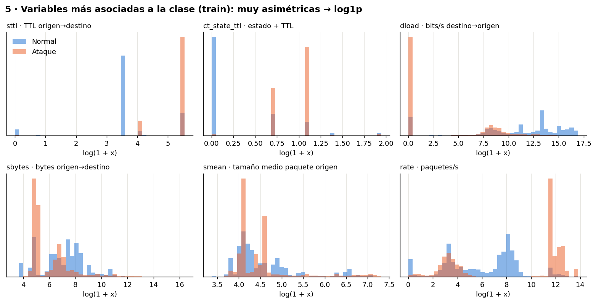
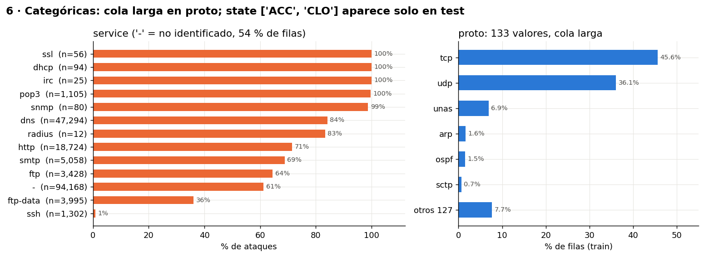

# EDA · UNSW-NB15

Resumen visual del análisis exploratorio. Detalle y código en
[notebooks/01_eda.ipynb](../notebooks/01_eda.ipynb); las figuras se regeneran con
`python scripts/eda_figures.py`.

## Contexto de los datos

- **Origen:** UNSW Canberra Cyber Range Lab (Australia), 2015. Tráfico generado con la
  herramienta IXIA PerfectStorm: actividad normal sintética mezclada con ataques de
  laboratorio. Se capturaron ~100 GB de pcap y se extrajeron features con Argus y Bro (Zeek).
- **Versión usada:** partición oficial *training/testing set* (UNSW, versión del 2024-02-09).
  Copia del docente en GitHub (commit `44bbd02`), idéntica byte a byte a la oficial.
- **Uso:** académico; citar a Moustafa & Slay (2015), *UNSW-NB15: a comprehensive data set
  for network intrusion detection systems*, MilCIS.
- **Limitación:** es un benchmark sintético de hace una década; un buen resultado no prueba
  eficacia sobre una red actual.

## Estructura

| Archivo | Filas | Normal | Ataque |
|---|---:|---:|---:|
| `UNSW_NB15_training-set.csv` | 175.341 | 56.000 (32 %) | 119.341 (68 %) |
| `UNSW_NB15_testing-set.csv` | 82.332 | 37.000 (45 %) | 45.332 (55 %) |

45 columnas, sin `NaN`:

| Rol | Columnas |
|---|---|
| Identificador (se descarta) | `id` |
| **Respuesta principal** | `label` (0 normal / 1 ataque) |
| Respuesta de ampliación | `attack_cat` (Normal + 9 familias) — determina `label`, nunca es entrada |
| Categóricas (3) | `proto` (133 valores), `service` (13), `state` (9) |
| Numéricas (39) | flujo (`dur`, `spkts`, `sbytes`, `rate`…), TTL (`sttl`, `dttl`), carga y pérdidas (`sload`, `sloss`…), tiempos TCP (`tcprtt`, `synack`…), contenido (`trans_depth`, `response_body_len`…) y contadores de ventana `ct_*` sobre las últimas 100 conexiones |

## Hallazgos

### 1. Clases

El ataque es mayoritario (al revés que en una red real) y su proporción baja de 68 % a 55 %
entre train y test. La accuracy no sirve: decir siempre "ataque" acierta 68 %. Familias
muy desbalanceadas (Worms: 130 filas).

### 2. El `id`

Es el número de fila 1…n de un archivo **ordenado por clase**. No tiene significado para el
problema → se elimina y se baraja antes de partir.

### 3. Repeticiones

42 % de train son copias exactas de otra fila (98 % en Generic); 229 grupos idénticos con
etiqueta contradictoria; 10,4 % del test aparece tal cual en train. → La validación se separa
**por grupos de filas idénticas** para que las copias no inflen el resultado.

### 4. Atajo del TTL

`sttl = 31` es siempre normal; 87 % de los ataques tiene `sttl = 254`. Es una huella de la
configuración del laboratorio, no del ataque → experimento con y sin variables de TTL.

### 5. Distribuciones

Variables muy asimétricas (bytes, cargas, tasas) → `log1p` + escalado para modelos lineales.

### 6. Categóricas

`service = '-'` (54 %) es un ausente codificado → categoría propia. `proto` tiene cola larga
→ agrupar raros. `state` trae en test valores no vistos en train (`ACC`, `CLO`) →
`OneHotEncoder(handle_unknown="ignore")`.

## Decisiones para la preparación

| Hallazgo | Decisión |
|---|---|
| BOM al inicio del CSV | leer con `encoding="utf-8-sig"` |
| `attack_cat` determina `label` | excluirla de las entradas |
| `id` = orden del archivo | eliminar y barajar |
| 42 % de copias en train | validación agrupada por hash de features; experimento con/sin deduplicar |
| 10 % del test ya está en train | test intacto y usado una vez; reportar también sin esas filas |
| `service='-'`, `state` nuevos, `proto` cola larga | categoría propia, `handle_unknown="ignore"`, agrupar raros |
| asimetría fuerte | `log1p` + escalado (lineales) |
| atajo `sttl` | experimento con y sin TTL |
| prevalencia distinta train/test | recall, precision, FPR y macro-F1; umbral elegido en validación |
