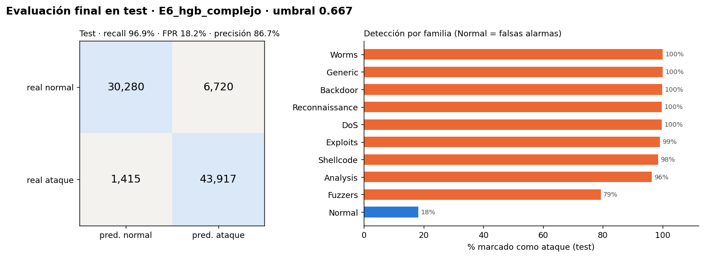

# Decisión final

## Modelo y umbral elegidos

| | |
|---|---|
| Modelo | **E6_hgb_complejo**: `HistGradientBoostingClassifier` (500 iteraciones máx., 63 hojas, lr 0,05) sobre log1p + escalado + one-hot |
| Umbral de alerta | **0,667** (probabilidad de ataque ≥ 0,667 → alerta) |
| Criterio | máximo recall en validación con FPR ≤ 5 %; desempate macro-F1 (fijado antes de entrenar) |
| Versión | MLflow Model Registry `defiende-el-servidor` **v1**, alias `champion`; ejecución `b1caa19139d54c2ea08d8984bcbb0399` |
| Copia exportada | `models/final/` (versionada con DVC, `models/final.dvc`) + `metadata.json` con umbral, commit y SHA-256 de los datos |
| Elección congelada | [seleccion.json](seleccion.json) |

**Por qué este modelo y no otro:** el gradient boosting (E3) supera a la regresión logística en
4 puntos de recall con la misma tasa de falsas alarmas; E6 añade 0,5 puntos más a un costo de
segundos. El equilibrio de clases (E2) no aporta una vez que el umbral se elige explícitamente.

**Por qué este umbral:** un analista de seguridad no puede revisar una avalancha de alertas
falsas, pero un ataque ignorado es más grave que una falsa alarma. Fijamos un presupuesto de
**5 % de conexiones normales alarmadas** y, dentro de él, detectamos el máximo de ataques.
Con 0,5 el modelo detectaría 97,6 % de ataques pero alarmaría 8,3 % del tráfico normal en
validación.

## Resultado en test (evaluado una sola vez)

| Métrica | Validación | **Test** | Test sin filas vistas en train |
|---|---:|---:|---:|
| Recall (ataques detectados) | 95,2 % | **96,9 %** | 96,3 % |
| Precisión (alertas correctas) | 97,6 % | **86,7 %** | 85,4 % |
| FPR (normales alarmadas) | 5,0 % | **18,2 %** | 17,7 % |
| Macro-F1 | 0,945 | **0,898** | 0,895 |
| ROC-AUC | 0,993 | 0,985 | — |

Matriz de confusión del test: 43.917 ataques detectados, **1.415 ataques no detectados**,
**6.720 falsas alarmas**, 30.280 normales correctas.

**El resultado empeoró y lo conservamos tal cual.** La tasa de falsas alarmas se multiplicó por
3,6 frente a lo que prometía la validación. El solapamiento train/test (10 % de filas) apenas
influye: sin esas filas el resultado es casi el mismo.

## Errores relevantes

- **Ataques no detectados:** 1.257 de los 1.415 son **Fuzzers** (21 % de esa familia pasa sin
  alerta). Los Fuzzers envían tráfico semi-aleatorio que se parece a conexiones normales.
  Le siguen Exploits (104) y Analysis (25). El resto de familias se detecta ≥ 98 %.
- **Falsas alarmas:** se concentran en conexiones normales con `sttl = 254` (39 % de ellas se
  alarman) y en estado `INT` (50 %). En el test, **41 % del tráfico normal tiene `sttl = 254`**,
  frente a 20 % en train/validación: el test contiene mucho más tráfico normal "con aspecto de
  atacante".

**Errores aceptados:** preferimos el sesgo hacia detectar (recall 97 %) a costa de falsas
alarmas, porque en un servidor un ataque ignorado tiene más costo que revisar una alerta. Pero
18 % de falsas alarmas **no es aceptable** para producción sin recalibrar (ver abajo).

## Por qué la validación no anticipó el test (análisis post-hoc)

> Este análisis se hizo **después** de ver el test. No cambia la decisión; sirve para entender
> el error. Datos en [analisis_post_hoc.csv](analisis_post_hoc.csv).

| Modelo | FPR validación | FPR validación con la mezcla de TTL del test | FPR test |
|---|---:|---:|---:|
| E1 logreg | 5,0 % | 10,7 % | 13,8 % |
| E3 HGB | 5,0 % | 10,6 % | 16,4 % |
| E4 HGB sin TTL | 5,0 % | 10,6 % | 16,1 % |
| E6 HGB complejo (elegido) | 5,0 % | 10,6 % | 18,2 % |

1. **El problema es el umbral, no la capacidad de ordenar:** ROC-AUC 0,985 en test. El modelo
   sigue separando bien, pero el punto de corte calibrado en validación no conserva la FPR.
2. **Es un cambio en la población normal entre archivos.** Reponderar la validación con la
   mezcla de TTL del test ya duplica la FPR esperada (5 % → 10,6 %), sin mirar el test.
3. **Quitar el TTL no lo arregla** (E4: 16,1 %): la diferencia del tráfico normal está en muchas
   variables a la vez.
4. Ningún modelo se habría salvado: todos se degradan. E6 se degrada algo más que E3
   (18,2 % vs 16,4 %), indicio leve de que la capacidad extra se ajustó a particularidades de
   train. Con el criterio fijado, la elección sigue siendo E6.

**Lección:** una tasa de falsas alarmas fijada en validación solo vale si el tráfico normal
futuro se parece al de entrenamiento. En una red real hay que **recalibrar el umbral con
tráfico normal reciente de esa red** y monitorear la tasa de alertas.

## Limitaciones del dataset

- **Sintético y antiguo:** tráfico generado con IXIA PerfectStorm en un laboratorio (2015). No
  prueba eficacia en una red actual; ataques y tráfico normal modernos son distintos.
- **Prevalencia irreal:** 68 % de ataques en train y 55 % en test. En una red real el ataque es
  raro: con la misma FPR, la precisión sería mucho menor (la mayoría de alertas serían falsas).
- **Artefactos del laboratorio:** el TTL identifica las máquinas atacantes del testbed; 42 % de
  filas repetidas en train; 229 grupos de filas idénticas con etiqueta contradictoria.
- **Train y test no son de la misma distribución:** la proporción de familias y el tipo de
  tráfico normal cambian entre archivos (ver arriba).
- **Variables `ct_*`** se calculan sobre las 100 conexiones previas; en producción
  requieren mantener ese estado en tiempo real.

## Si perdiéramos el entorno local

Con el repositorio de GitHub y el remoto DVC (`/home/mjcas/dvc-storage/defiende-el-servidor`):
`git clone` → `pip install -r requirements.txt` → `dvc pull` recupera datos, particiones,
modelo y registros de MLflow exactos. Sin el remoto DVC, `scripts/download_data.sh` verifica
los datos por SHA-256 y `python -m flows.pipeline` reconstruye todo de forma determinista
(semilla 42).
