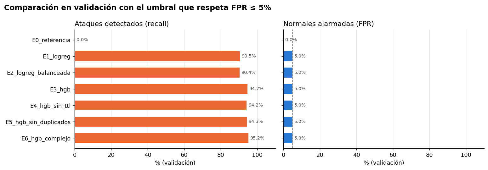

# Comparación de experimentos

Todos los experimentos usan **las mismas particiones** (train 140.779 / validación 34.562,
agrupadas por filas idénticas, semilla 42), el mismo preprocesamiento (log1p + escalado +
one-hot con categorías raras agrupadas) y la misma política de alerta: **el umbral se elige en
validación para maximizar el recall sin superar 5 % de falsos positivos**. Las hipótesis se
escribieron en [params.yaml](../params.yaml) antes de entrenar (commit `86d0212`).

Registros: MLflow, experimento `defiende-el-servidor`
(`mlflow ui --backend-store-uri sqlite:///mlflow/mlflow.db`). Cada ejecución guarda tags
`question`, `hypothesis`, `change`, `compare_to` y `git_commit`, los datasets de entrada, las
métricas y el modelo completo (preprocesamiento + clasificador).

## Resultados en validación

Con el umbral elegido (FPR ≤ 5 %):

| Experimento | Recall | Precisión | FPR | Macro-F1 | ROC-AUC | Umbral | Filas train | Entreno (s) |
|---|---:|---:|---:|---:|---:|---:|---:|---:|
| E0 referencia | 0,0 % | — | 0,0 % | 0,243 | 0,500 | 1,000 | 140.779 | 0,6 |
| E1 logreg | 90,5 % | 97,5 % | 5,0 % | 0,911 | 0,986 | 0,789 | 140.779 | 24,1 |
| E2 logreg balanceada | 90,4 % | 97,5 % | 5,0 % | 0,910 | 0,986 | 0,635 | 140.779 | 16,6 |
| E3 HGB | 94,7 % | 97,6 % | 5,0 % | 0,941 | 0,992 | 0,658 | 140.779 | 3,8 |
| E4 HGB sin TTL | 94,2 % | 97,6 % | 5,0 % | 0,938 | 0,992 | 0,667 | 140.779 | 3,9 |
| E5 HGB sin duplicados | 94,3 % | 97,6 % | 5,0 % | 0,939 | 0,992 | 0,664 | 81.011 | 1,8 |
| **E6 HGB complejo** | **95,2 %** | **97,6 %** | **5,0 %** | **0,945** | **0,993** | **0,667** | 140.779 | 14,5 |

Con umbral fijo 0,5 (como referencia):

| Experimento | Recall | FPR | Macro-F1 |
|---|---:|---:|---:|
| E0 | 100 % | 100 % | 0,404 |
| E1 | 97,5 % | 13,4 % | 0,930 |
| E2 | 94,0 % | 8,1 % | 0,924 |
| E3 | 97,3 % | 8,9 % | 0,946 |
| E4 | 97,4 % | 9,3 % | 0,945 |
| E5 | 97,4 % | 9,0 % | 0,946 |
| E6 | 97,6 % | 8,3 % | 0,950 |

## Experimento por experimento

### E0 · Referencia (`DummyClassifier`)
- **Pregunta:** ¿cuál es el piso?
- **Hipótesis:** con FPR ≤ 5 % no detecta nada; con umbral 0,5 lo marca todo.
- **Resultado:** recall 0 % con el umbral de política; con 0,5, recall 100 % y FPR 100 %
  (accuracy 68 %, igual a la prevalencia).
- **Conclusión:** ✅ confirmada. Muestra por qué la accuracy no sirve aquí: un modelo inútil
  logra 68 %.

### E1 · Regresión logística (vs. E0)
- **Pregunta:** ¿basta un modelo lineal?
- **Hipótesis:** ROC-AUC > 0,95, pero las no linealidades limitarán el recall con FPR ≤ 5 %.
- **Resultado:** ROC-AUC 0,986; recall 90,5 % con FPR 5 %. Deja pasar 9,5 % de los ataques.
- **Conclusión:** ✅ confirmada. Es una base fuerte y barata, pero no la mejor.

### E2 · Logística con clases balanceadas (vs. E1)
- **Pregunta:** ¿equilibrar las clases cambia los errores?
- **Hipótesis:** con umbral 0,5 baja la FPR a costa de recall; con el umbral ajustado, la
  diferencia es pequeña.
- **Resultado:** con 0,5, la FPR baja de 13,4 % a 8,1 % y el recall de 97,5 % a 94,0 %.
  Con el umbral ajustado: 90,4 % vs 90,5 % (prácticamente igual).
- **Conclusión:** ✅ confirmada. **Equilibrar las clases solo desplaza el umbral**; si el umbral
  se elige explícitamente con la política de alerta, no aporta nada. Lo descartamos.

### E3 · Gradient boosting (vs. E1)
- **Pregunta:** ¿más complejidad de modelo mejora el resultado?
- **Hipótesis:** mejor recall con FPR ≤ 5 % gracias a interacciones y umbrales.
- **Resultado:** recall 94,7 % vs 90,5 % (+4,2 puntos) con la misma FPR, y **6 veces más rápido**
  de entrenar (parada temprana).
- **Conclusión:** ✅ confirmada. Es el cambio que más aporta de todo el estudio.

### E4 · HGB sin variables de TTL (vs. E3)
- **Pregunta:** ¿cuánto depende el modelo del atajo de TTL del laboratorio?
- **Hipótesis:** baja, pero poco.
- **Resultado:** recall 94,2 % vs 94,7 % (−0,4 puntos).
- **Conclusión:** ✅ confirmada en validación. El modelo **no depende** del TTL: las otras
  variables de flujo tienen casi la misma información. *Ver también el análisis post-hoc en la
  decisión final: quitar el TTL tampoco evita la degradación en test.*

### E5 · HGB sin filas repetidas (vs. E3)
- **Pregunta:** ¿las copias ayudan o sesgan?
- **Hipótesis:** con 42 % menos filas, mucho menos costo y casi el mismo resultado.
- **Resultado:** 81.011 filas en vez de 140.779; la mitad del tiempo; recall 94,3 % vs 94,7 %.
- **Conclusión:** ✅ confirmada. Las copias aportan poco. Como la validación ya es agrupada, el
  resultado de E3 no está inflado por ellas; se conserva el entrenamiento con todas las filas,
  porque también es la población del test.

### E6 · HGB con más capacidad (vs. E3)
- **Pregunta:** ¿más capacidad compensa su costo?
- **Hipótesis:** mejora < 1 punto a cambio de varias veces más tiempo.
- **Resultado:** recall 95,2 % vs 94,7 % (+0,5 puntos), 3,8 veces más tiempo (14,5 s vs 3,8 s).
- **Conclusión:** ✅ confirmada. La mejora es real pero marginal; el costo absoluto sigue siendo
  bajo (segundos), así que según el criterio fijado de antemano es el elegido.

## ¿Qué experimento cambió nuestra opinión?

- **E2:** esperábamos que balancear clases fuera importante por la prevalencia invertida.
  Resultó equivalente a mover el umbral: la decisión que importa es el umbral, no el peso.
- **E4 + análisis post-hoc del test:** suponíamos que el atajo de TTL era el principal riesgo
  de generalización. En validación el modelo no depende de él, y en test **todos** los modelos
  (con y sin TTL) suben su tasa de falsas alarmas. El problema no es una variable concreta,
  sino que el tráfico normal del archivo de test es distinto (ver
  [decision_final.md](decision_final.md)).

## ¿Por qué la comparación es justa?

- Mismas particiones para todos, guardadas en `data/processed` y versionadas con DVC.
- Validación **agrupada por filas idénticas**: ninguna copia está en train y en validación a la vez.
- Cada experimento cambia **una sola decisión** respecto a su comparación (`compare_to`).
- El umbral de cada modelo se elige con la misma regla (FPR ≤ 5 % en validación).
- Selección automática con un criterio escrito antes de entrenar; el test no se usó para elegir.
